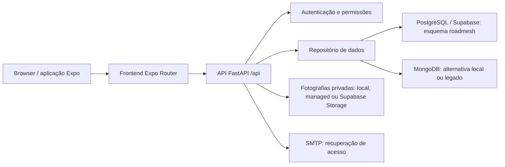

# RoadMesh — documentação do projeto

**Versão documentada:** branch `codex/roadmesh-auditoria-melhorias`, sobre `8a55d9d`.
**Data:** 20 de outubro de 2026. **Estado:** versão local validada automaticamente, com condições de publicação pendentes; não corresponde ainda à versão publicada.

Este documento explica a arquitetura, utilização, regras de negócio, instalação e operação. O relatório [ALTERACOES.md](ALTERACOES.md) descreve o trabalho efetuado, evidências, limitações e correspondência com o pedido de auditoria.

## 1. Finalidade e áreas da aplicação

A RoadMesh gere oficinas independentes numa plataforma comum. Inclui clientes, viaturas, marcações, avaliações do cliente, ordens de serviço, peças, fornecedores, stock, encomendas, fotografias, danos, orçamentos, documentos internos e pagamentos.

| Área | Destinatário | Operações principais |
|---|---|---|
| Administração | Administração RoadMesh | Criar e gerir oficinas, criar responsáveis e colaboradores, bloquear/arquivar oficinas e prestar suporte auditado |
| Oficina | Responsável e colaboradores | Clientes, viaturas, marcações, ordens de serviço, orçamentos e inventário, conforme permissões |
| Cliente | Cliente convidado pela oficina | Consultar os seus carros, marcações e dados disponibilizados pelo portal |

O acesso é único em `/login`: administração RaRo/RoadMesh, oficinas e clientes usam o mesmo formulário de email e palavra-passe. O servidor autentica a conta em `POST /api/auth/login` e devolve o papel guardado em `roadmesh.users`; a aplicação encaminha para administração, oficina ou portal do cliente. O papel não é deduzido do domínio do email nem escolhido pelo utilizador. Os endereços antigos `/admin-login` e `/client-login` encaminham para `/login`. As permissões da API e a troca obrigatória de palavra-passe temporária continuam aplicáveis.

Os cabeçalhos partilhados não apresentam títulos centrados no topo; mantêm navegação e ações. O favicon web usa `roadmesh-favicon.png`, com fundo branco; o logótipo apresentado na aplicação mantém o seu ficheiro original.

Não existe registo público livre. Uma oficina é criada pela administração. Os acessos de cliente e colaborador são provisionados por um operador autorizado. As credenciais temporárias têm de ser alteradas no primeiro acesso.

## 2. Arquitetura



A variável `DATABASE_URL`, quando preenchida, seleciona PostgreSQL. Caso contrário, são usadas `MONGO_URL` e `DB_NAME`. Não se escreve simultaneamente nos dois motores e não existe sincronização automática entre eles.

O Supabase é utilizado como PostgreSQL e, opcionalmente, como armazenamento privado. A autenticação da aplicação é própria, com utilizadores na tabela `roadmesh.users`: **não depende do Supabase Authentication** nem cria automaticamente contas em `auth.users`.

### Tecnologias

- Frontend: Expo SDK 57, Expo Router, React 19, React Native, TypeScript, TanStack Query e componentes partilhados.
- Backend: Python 3.12 no ambiente de validação, FastAPI, Pydantic, bcrypt e JWT.
- PostgreSQL: Psycopg 3 com pool e ligações TLS remotas; compatibilidade com pooler de transações.
- MongoDB: Motor/PyMongo; requer replica set ou Atlas para transações.
- Documentos PDF: ReportLab. Imagens: Pillow, com limite de tamanho, orientação e redução de resolução.
- Testes: pytest/xdist, testes Node, TypeScript, ESLint e Ruff.

As versões exatas estão em `backend/requirements*.txt`, `frontend/package.json` e `frontend/yarn.lock`.

### Organização

| Caminho | Responsabilidade |
|---|---|
| `backend/server.py` | Aplicação, modelos e rotas de negócio existentes |
| `backend/access_control.py` | Autenticação, sessões, funções, contexto de suporte e auditoria |
| `backend/admin_routes.py`, `portal_routes.py` | Administração e portal do cliente |
| `backend/business_rules.py` | Normalização, duplicados, dinheiro, margens, preços e anos civis |
| `backend/operations.py` | Configurações, fornecedores, rascunhos, reposição, receções e livro financeiro |
| `backend/history_routes.py` | Históricos paginados e anos com registos |
| `backend/postgres_database.py` | Adaptação do repositório existente a SQL parametrizado e tabelas relacionais |
| `backend/database_integrity.py` | Transações e índices; compatibilidade de identificadores MongoDB |
| `backend/media_storage.py` | Validação, carregamento e leitura autorizada de fotografias |
| `backend/password_recovery.py` | Tokens de uso único e transporte SMTP |
| `backend/request_logging.py` | Diagnóstico estruturado de pedidos |
| `backend/sql/` | Migrações e verificações prévias |
| `frontend/app/` | Páginas agrupadas por administração, oficina e autenticação/portal |
| `frontend/src/components/` | Formulários, modais, históricos, cartões e componentes comuns |
| `frontend/src/api.ts`, `auth.tsx`, `session.ts` | Pedidos, contexto e ciclo de sessão |
| `frontend/src/utils/pricing.ts` | Cálculo decimal da margem no frontend |
| `scripts/` | Preparação de demonstração e verificações de migração |
| `docs/` | Documentação e evidências com dados fictícios |

A pasta `frontend/RoadMesh/` é um projeto de exemplo separado, preexistente e não incluído no build principal. Não deve ser confundida com o frontend em `frontend/`.

## 3. Permissões e isolamento

As funções autenticadas são `admin`, `workshop_staff` e `client`. O responsável é um colaborador designado em `workshops.manager_id`; a compatibilidade com `users.is_manager` só é usada quando essa designação não existe. Um campo enviado pelo browser não concede privilégios.

| Operação | Colaborador | Responsável | Administração |
|---|---|---|---|
| Clientes, viaturas e trabalho corrente da sua oficina | Sim | Sim | Contexto de suporte validado |
| Consultar preço/hora | Sim | Sim | Suporte |
| Alterar preço/hora, catálogo/preços e stock manual | Não | Sim | Suporte auditado |
| Criar linhas com preços do catálogo/configuração | Sim | Sim | Suporte |
| Definir preços avulsos | Não | Sim | Suporte |
| Preparar rascunho de encomenda | Sim | Sim | Suporte |
| Validar, receber e cancelar encomenda | Não | Sim | Suporte |
| Emitir documento e registar movimentos financeiros | Não | Sim | Suporte |
| Reabrir ordem concluída | Não | Sim, sem documentos emitidos | Suporte |
| Eliminar ordem em Entrada | Sim, sem documentos | Sim, sem documentos | Suporte |
| Eliminar ordem noutro estado | Não | Sim, sem documentos | Suporte |
| Gestão global de oficinas | Não | Não | Sim |

As consultas e alterações usam o contexto da oficina autenticada. O portal limita os dados ao cliente autenticado. A administração só entra na área operacional através do mecanismo de suporte, com aviso visível e registo do ator real.

O esquema SQL `roadmesh` fica privado, com RLS e sem permissões para as contas de browser `anon` e `authenticated`. Não o adicionar aos esquemas expostos pela Data API. A migração opcional `004_runtime_role.sql` permite um login específico do backend, com menos privilégios que o proprietário da base e sem reescrita de movimentos financeiros, receções ou auditoria.

Isto não equivale a uma certificação de segurança nem substitui revisão de infraestrutura e credenciais antes da publicação.

## 4. Regras de negócio

### Clientes, viaturas e duplicados

Os identificadores são normalizados para comparar diferenças de espaços, capitalização e separadores. Os critérios são específicos: NIF e conjunto completo de dados do cliente; matrícula e VIN da viatura; referência e código de barras do produto; nome normalizado do fornecedor; email de utilizador. Partilhar apenas um telefone ou um nome não impede um cliente legítimo.

Existem validações na API, transações e índices únicos. Conflitos devolvem uma mensagem clara com estado 409. A migração para os índices não elimina nem funde registos existentes.

Foi encontrado um conflito no backup fornecido: dois clientes na mesma oficina. A publicação depende da revisão desse conflito. Ver o plano no relatório de alterações.

### Mão de obra e preços

Em Mais → Configurações da oficina, o responsável define preço/hora sem IVA e taxa de IVA. Nos novos orçamentos e ordens, o utilizador indica horas; a descrição é opcional. O valor aplicado é guardado em cada linha. Alterar a configuração não recalcula documentos existentes.

Os colaboradores podem usar preços autorizados do catálogo ou da configuração. A API recusa preços/IVA manipulados. Linhas anteriores podem manter o preço histórico quando são alterados outros dados de uma ordem ainda editável.

### Margem

A margem é calculada sobre o preço de venda, não sobre o custo:

`preço de venda = custo / (1 − margem/100)`

Exemplo: custo de 80 € e margem de 20% originam venda de 100 €, sem IVA. Aceitam-se margens de 0% a menos de 100%; a margem 100% não tem preço finito. O arredondamento é feito aos cêntimos. A margem efetiva apresentada pode diferir ligeiramente da introduzida devido a esse arredondamento.

### Stock e encomendas

Cada alteração de stock produz um movimento. A operação e os seus efeitos pertencem à mesma transação: não se pode guardar uma ordem e deixar o stock alterado a meio. Cálculos decimais evitam resíduos em consumos fracionados; os preços das linhas não são arredondados antes do cálculo dos totais.

“Adicionar à encomenda” abre/reutiliza um rascunho persistente do fornecedor. Não duplica a linha do mesmo produto. É possível alterar quantidades e remover linhas antes da validação. Produtos com fornecedores diferentes são separados. A alteração de fornecedor de um produto com encomendas abertas é bloqueada até essas relações serem resolvidas.

A reposição automática é opcional por produto. Quando o stock atinge ou desce abaixo do mínimo, cria uma proposta “Por validar”, ou reutiliza uma necessidade já aberta. A quantidade sugerida procura repor até duas vezes o mínimo, arredondada para unidades inteiras, com pelo menos uma unidade. O responsável pode revê-la. Não há envio automático nem validação automática ao fornecedor.

Estados: `rascunho`, `por_validar`, `pendente`, `parcial`, `recebida`, `cancelada`.

A receção aceita quantidades parciais e uma chave de repetição. Repetir a mesma confirmação não volta a somar stock. A API recusa produto alheio à encomenda, código incorreto, excesso e linhas repetidas. São guardados utilizador, data e itens. O caminho de receção integral sem corpo mantém compatibilidade com clientes anteriores e continua reservado ao responsável.

Leitores USB/Bluetooth que funcionam como teclado podem preencher o código. A câmara web é uma melhoria opcional: requer HTTPS/permissão e suporte a `BarcodeDetector`. A identificação não confirma a receção. Em navegadores sem suporte e na versão nativa sem módulo de câmara dedicado, mantém-se leitura física/entrada manual. A API da câmara tem [disponibilidade limitada](https://developer.mozilla.org/en-US/docs/Web/API/BarcodeDetector).

### Ordens de serviço e rastreabilidade

A relação cliente–viatura é validada no servidor. Alterar o cliente limpa a viatura nos novos formulários. Os modais fazem pesquisa no servidor.

Reabrir ou eliminar fora de Entrada exige responsável. Ordens com documentos emitidos não podem ser alteradas ou eliminadas por estas rotas. Mudanças de estado registam anterior/seguinte, utilizador e data. A eliminação permitida guarda snapshot na auditoria e repõe stock na mesma transação.

A eliminação física permitida foi mantida para compatibilidade, com auditoria e proteção das relações. Não se introduziu uma nova interpretação de “arquivado” nas ordens. Oficinas são arquivadas logicamente: os dados permanecem e os acessos são bloqueados.

### Faturação e livro financeiro

Os documentos produzidos são **internos, sem validade fiscal certificada**. Não substituem software de faturação adequado nem aconselhamento contabilístico.

- Emitir FT/FR cria um valor pendente, sem confirmar dinheiro recebido.
- Uma FT e uma FR da mesma ordem não duplicam a cobrança.
- Pagamento parcial reduz o pendente pelo valor confirmado.
- Estorno referencia um pagamento anterior e não pode exceder o valor reversível.
- Crédito interno reduz o valor a receber e mantém o histórico.
- Se houver excesso a devolver após um ajuste, o painel mostra-o separadamente.
- Todos os movimentos têm ator, data, valor, motivo e referência; pagamentos incluem método.
- Repetições com a mesma chave e os mesmos dados devolvem o movimento anterior. A mesma chave com outros dados é recusada.
- O saldo é derivado dos movimentos; não existe um campo editável de saldo.

`pendente = cobranças − créditos − pagamentos líquidos`, apresentado separadamente de valores a devolver. “Recebido líquido” é operacional; não é saldo bancário. Os totais agregam saldos por ordem para evitar que um crédito numa ordem esconda uma dívida noutra.

Documentos antigos não têm pagamentos históricos inventados. Exigem reconciliação explícita como pendentes antes de novos pagamentos. As notas/créditos aqui registados não são notas de crédito fiscais.

### Históricos, navegação e interface

Mais → Históricos e movimentos apresenta stock, receções, encomendas, ordens, orçamentos, documentos, fotografias, danos e, para responsáveis, pagamentos/ajustes. Existem paginação e seleção dos anos com registos. Os limites anuais são calculados em `Europe/Lisbon` e convertidos para UTC. Há filtros anuais também nas listas de ordens, orçamentos, faturas e encomendas.

O botão Voltar usa o histórico real; as tabs mantêm histórico e as listas conservam filtros durante a navegação. Sem histórico válido existe um destino seguro. O cache de interface é limpo na mudança de sessão/oficina de suporte.

Os formulários usam áreas de segurança, controlo de teclado e largura limitada no desktop. A revisão em viewport móvel não substitui testes num iPhone físico, Safari/PWA e leitores reais.

## 5. Ambiente e configuração

Copiar os exemplos para ficheiros locais ignorados pelo Git. Nunca adicionar `.env`, exportações ou palavras-passe ao repositório.

| Variável | Local | Finalidade |
|---|---|---|
| `DATABASE_URL` | Backend | URI privada PostgreSQL; quando preenchida seleciona esse motor |
| `DATABASE_POOL_SIZE` | Backend | Limite de ligações por instância, normalmente 4 |
| `MONGO_URL`, `DB_NAME` | Backend | MongoDB quando `DATABASE_URL` está vazia |
| `JWT_SECRET` | Backend | Segredo aleatório com pelo menos 32 caracteres; alterar termina sessões anteriores |
| `BOOTSTRAP_ADMIN_EMAIL`, `BOOTSTRAP_ADMIN_PASSWORD` | Backend | Provisionamento inicial da administração; palavra-passe forte e alteração no primeiro acesso |
| `CORS_ORIGINS` | Backend | Origens exatas dos frontends autorizados, separadas por vírgulas |
| `STORAGE_DRIVER` | Backend | `local`, `managed` ou `supabase` |
| `LOCAL_MEDIA_ROOT` | Backend local | Pasta privada persistente; não usar como armazenamento durável na Vercel |
| `EMERGENT_LLM_KEY`, `INTEGRATION_PROXY_URL` | Backend managed | Integração de armazenamento antiga, preservada por compatibilidade |
| `SUPABASE_URL`, `SUPABASE_SERVICE_ROLE_KEY`, `SUPABASE_STORAGE_BUCKET` | Backend supabase | Acesso do servidor a bucket privado; nunca usar prefixo `EXPO_PUBLIC_` |
| `EXPO_PUBLIC_BACKEND_URL` | Frontend, no build | Origem da API, sem `/api` final; vazio só quando existe proxy na mesma origem |
| `SMTP_*`, `PASSWORD_RESET_URL` | Backend | Recuperação de acesso, conforme secção seguinte |

As variáveis `EXPO_PUBLIC_*` são públicas no bundle. `DATABASE_URL`, JWT, passwords e chaves de serviço pertencem exclusivamente ao backend.

### Email de recuperação — procedimento sem serviço contratado

O utilizador confirmou que ainda não tem serviço de email. Não foi criada conta nem enviado email real.

1. Escolher um fornecedor SMTP e um endereço remetente autorizado. Configurar domínio, SPF/DKIM e restantes verificações exigidas por esse fornecedor.
2. Guardar no backend, em privado: `SMTP_HOST`, `SMTP_PORT` (587 com STARTTLS ou 465 com TLS), `SMTP_USERNAME`, `SMTP_PASSWORD` e `SMTP_FROM`.
3. Configurar `PASSWORD_RESET_URL=https://<frontend>/reset-password`, sem query nem fragmento.
4. Na Vercel, aplicar os valores aos ambientes corretos e fazer novo deployment, depois da migração e revisão de publicação.
5. Pedir recuperação para uma conta de teste autorizada; verificar entrega, spam, remetente e URL.
6. Confirmar alteração, impossibilidade de reutilizar o link, expiração e invalidação de sessões anteriores.

O token tem 20 minutos e uso único; só o digest é persistido. Os pedidos públicos dão uma resposta genérica para não revelar contas. Sem SMTP configurado, essa resposta não prova que houve envio. Não utilizar tokens/logs como substituto de entrega de email. A recuperação nativa por deep link não foi certificada nesta entrega; o fluxo documentado é HTTPS/web.

### Fotografias privadas no Supabase

A Vercel não deve guardar fotografias no disco efémero da função. Para usar Supabase Storage:

1. Criar no Dashboard um bucket **privado** chamado, por exemplo, `roadmesh-media`, com limite adequado às imagens da aplicação (10 MB de upload) e tipo permitido JPEG para as imagens processadas.
2. Configurar `STORAGE_DRIVER=supabase`, URL do projeto, chave de serviço exclusiva do backend e nome do bucket.
3. Não criar URLs públicas nem políticas de leitura pública para fotografias de clientes.
4. Testar upload e leitura autenticada com oficina e cliente de teste; verificar recusa por outra oficina.
5. Se existirem ficheiros no fornecedor antigo, manter as suas credenciais até uma migração de ficheiros explicitamente validada. O fornecedor fica associado aos novos registos; não se movem ficheiros automaticamente.

O arranque valida configuração sem chamar o armazenamento externo em cada cold start. A comunicação só acontece quando uma fotografia é efetivamente utilizada. O contrato foi testado com respostas controladas e, em 21/10, houve upload/leitura real no bucket privado da base de testes. O fornecedor de produção ainda precisa da sua configuração e verificação próprias. Ver [buckets privados](https://supabase.com/docs/guides/storage/buckets/fundamentals) e [acesso do servidor](https://supabase.com/docs/guides/storage/security/access-control).

## 6. Instalação e execução

### Demonstração local

Seguir `TESTAR.md`. Os iniciadores `dev.sh` e `Iniciar-Testes.command` usam a demonstração local. Os dados de demonstração ficam em `.demo/`, separados dos dados de produção. `--lan` permite acesso na rede local; não publica na Internet.

### Desenvolvimento

```sh
cd backend
python3 -m venv .venv
.venv/bin/pip install -r requirements-dev.txt
# Configurar .env privado e base de testes adequada.
.venv/bin/uvicorn server:app --reload --port 8000
```

```sh
cd frontend
npx --yes yarn@1.22.22 install --frozen-lockfile
# Configurar EXPO_PUBLIC_BACKEND_URL antes de iniciar/exportar.
npx expo start --web
```

A ferramenta local `.demo/venv` é uma instalação de trabalho, não uma dependência que deva ser publicada.

## 7. Base de dados, migrações e publicação

### Modelo PostgreSQL

Há 27 tabelas no esquema `roadmesh`. As relações centrais são oficina → clientes → viaturas → ordens; as linhas de ordens/orçamentos/encomendas têm tabelas próprias. Cada relação relevante inclui a oficina para impedir cruzamentos indevidos. Campos de extensão compatíveis com o backend anterior ficam em `metadata`.

As cinco tabelas do conjunto 003 são `suppliers`, `financial_movements`, `order_receipts`, `reorder_needs` e `password_resets`. Movimentos financeiros e receções têm proteção SQL contra alterações/eliminação. Existem índices de chaves de repetição, cobrança única por serviço, necessidade única por produto e rascunho aberto por fornecedor.

### Ordem segura

1. Confirmar um backup atual e recuperável, incluindo ficheiros quando existirem.
2. Numa base nova: executar `001_initial.sql`, `002_backend_compatibility.sql`, `003_business_modules.sql`; opcionalmente `004_runtime_role.sql` para um login dedicado.
3. Numa base existente versão 2: **não repetir 001/002**. Executar apenas a consulta de leitura `003_preflight.sql` e rever os conflitos antes de 003.
4. Resolver os dois clientes duplicados com decisão explícita, depois de verificar relações. Nunca eliminar/fundir automaticamente.
5. Restaurar uma cópia atual em staging e validar 003, contagens, relações e regressões.
6. Preparar backend/variáveis e frontend/variáveis. O novo backend exige o esquema versão 3; não publicar antes da migração.
7. Rever e publicar apenas quando os impedimentos do relatório estiverem resolvidos. Esta auditoria não executou migrações nem deployment em produção.
8. Verificar `/api/`, login dos três perfis, isolamento, criação de trabalho, stock, encomenda, documento, pagamento, foto e recuperação.

O esquema `public` antigo e `auth` não são removidos por estas migrações. A transação de 003 para integralmente se encontrar conflito; é necessário rollback explícito quando o editor mantém uma transação abortada.

Na Vercel são projetos separados: backend com raiz `backend` e frontend com raiz `frontend`. O frontend exporta para `dist`; as rotas SPA têm rewrite. A raiz `/` da API não é uma página da aplicação: o health check é `/api/`.

### Backup e recuperação

O backup fornecido cobre apenas o esquema `roadmesh` versão 2: 22 tabelas, 406 registos, sem referências a ficheiros em `media`. Foi restaurado e comparado localmente. Não é um backup de todo o projeto Supabase. A cópia privada está em `.demo/backups/`, ignorada pelo Git; não incluir conteúdos nem dados pessoais na documentação.

O pacote de recuperação original é específico da versão 2. Depois da migração para versão 3, produzir um novo backup que inclua as 27 tabelas. Usar export/restore PostgreSQL completo do esquema e ficheiros do bucket; não reutilizar um exportador de 22 tabelas como se fosse completo. Testar a recuperação numa base separada e manter cópia privada fora deste computador.

## 8. Testes e diagnóstico

```sh
# Na raiz, com ambiente de desenvolvimento instalado:
python backend/tests/run_local.py --mongod /caminho/para/mongod -x -q
python backend/tests/run_postgres.py -x -q

# PostgreSQL incorporado, alternativa limitada quando o nativo não pode arrancar:
python backend/tests/run_postgres.py --pglite-runtime /pasta/com/node_modules -x -q

# Em frontend:
npm run typecheck
npm run lint
node --test scripts/session.test.cjs scripts/pricing.test.cjs
npx expo export -p web
```

Os runners criam bases descartáveis e contas fictícias. Não apontar a suite para Supabase/produção. O runner PostgreSQL nativo precisa das ferramentas adicionais indicadas no próprio ficheiro (`pgserver`); a alternativa PGlite precisa de `@electric-sql/pglite` e `@electric-sql/pglite-socket`.

O PGlite é um servidor de uma ligação multiplexada e não substitui testes de concorrência em PostgreSQL nativo. Foi necessária compatibilidade de protocolo **apenas no runner incorporado**; a produção continua com SQL parametrizado do servidor e sem prepared statements persistentes no pooler.

O logging inclui identificador do pedido, método, rota sem parâmetros, estado e duração. Não inclui corpo, query string, JWT, email nem exceção completa de fornecedores. Um erro 500 devolve identificador para diagnóstico. Respostas 401/403 podem representar proteção correta, não falha interna; devem ser analisadas por causa e rota.

O relatório de alterações regista resultados efetivos e testes manuais. Validar ainda dispositivos físicos, email e armazenamento real antes de considerar a versão pronta para publicação.

## Continuação: ensaio sobre o backup real

O ensaio local de resolução do cliente sem relações, migração para 27 tabelas, rollback e restauro integral do backup versão 3 passou. A produção não foi alterada. Ver [procedimento e estado atual](PUBLICAR.md). Ainda falta a base Supabase de testes, que o utilizador confirmou não existir.

## Validação adicional — 21 de outubro de 2026

O RoadMesh-Testes foi criado e validado com PostgreSQL 17 real, ligação TLS pelo pooler de sessão IPv4. As migrações 001–004 passaram numa base inicialmente sem esquema RoadMesh; estão confirmadas 27 tabelas. A suite remota terminou com **97 testes aprovados e 2 exclusivos de MongoDB omitidos**, em 14 min 23 s. O teste de `SET ROLE roadmesh_runtime` foi excluído explicitamente após o titular recusar a concessão de membership; não foi concedida essa permissão. A primeira tentativa parou com 31 aprovados e essa falha de preparação, sem falha da API. Consultas de leitura confirmaram os privilégios declarados do papel, sem substituir o teste real de sessão.

O bucket privado `roadmesh-media` foi criado por autorização específica: JPEG, 10 MB, sem políticas públicas. O driver enviou e leu uma imagem fictícia de 633 bytes; o conteúdo foi comparado e o acesso pela rota pública foi recusado. A chave ficou exclusivamente no ficheiro privado de staging do backend; não foi adicionada ao Git ou impressa.

Foi exportado um snapshot consistente da base de testes com 27 tabelas e 1 358 registos. O restauro local numa base vazia comparou integralmente todas as linhas e verificou relações. Este backup é da base de testes, não da produção, e não inclui bytes das fotografias do bucket. Os ficheiros locais temporários usados pela suite genérica não fazem parte desse backup; os respetivos dados fictícios não devem ser considerados uma demonstração persistente de fotografias.

[Evidência Supabase](evidencias/validacao-supabase.json), [restauro](evidencias/restauro-staging.json), [privilégios](evidencias/permissoes-staging.json) e [imagem privada](evidencias/storage-staging-roundtrip.json). A suite genérica usou armazenamento local; o teste de transporte posterior usou Supabase Storage real. O relatório de testes adicionais da API de imagens é guardado separadamente quando terminar.

Estas verificações substituem a pendência de concorrência funcional em PostgreSQL incorporado por testes numa base real com pedidos paralelos; não constituem benchmark de carga, validação do pooler de transações, teste físico de iPhone/leitor ou migração da produção. A resolução dos clientes duplicados permanece ensaiada apenas numa cópia local e requer revisão atual antes da publicação.

### Fotografias pela API — concluído em 21/10

Passaram **3 testes adicionais** com PostgreSQL e Supabase Storage reais: upload/download autenticado, recusa de leitura por outra oficina e ficheiros inválidos/demasiado grandes. Foram usados dados e imagens fictícios. A chave service_role existente foi copiada pelo utilizador diretamente para o ficheiro privado do backend e não foi impressa nem guardada num ficheiro temporário. A produção não foi alterada.
